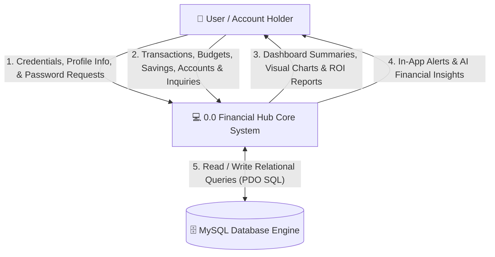
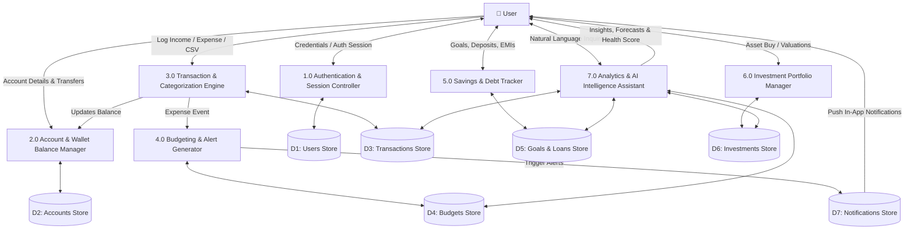
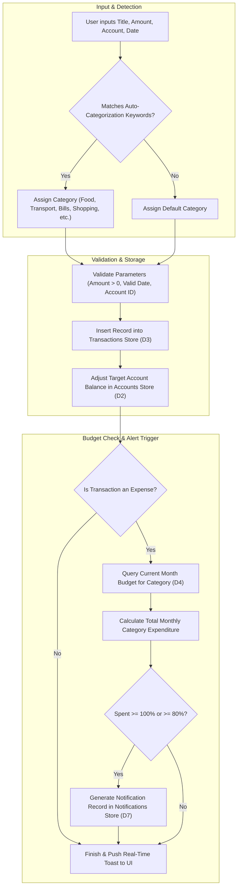
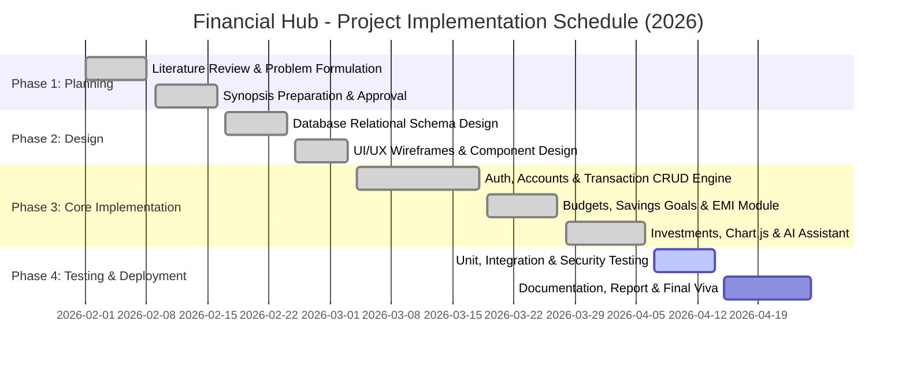

# Synopsis
### on
## **FINANCIAL HUB – SMART PERSONAL FINANCE, SAVINGS & WEALTH ANALYTICS SYSTEM**
#### *to be developed to fulfill the requirements for*
### **Major Project**

**Submitted to:**  
**Department of Computer Applications**  
**CGC University, Mohali, Punjab**  

**Under the supervision of:**  
**[Faculty Guide Name]**  
[Designation, e.g., Assistant Professor]  
Department of Computer Applications  

**Submitted by:**  

| Student 1 | Student 2 *(Optional)* | Student 3 *(Optional)* |
| :--- | :--- | :--- |
| **Rehan Mohd** | [Student Name] | [Student Name] |
| **Roll No.:** [Your Roll No.] | **Roll No.:** [Roll No.] | **Roll No.:** [Roll No.] |
| **Section:** [Your Section] | **Section:** [Section] | **Section:** [Section] |

**Bachelor of Computer Applications (BCA) – 6th Semester**  
**(Batch: 2024–2027)**  

---

**Chandigarh School of Business (CSB)**  
*Building Careers. Transforming Lives.*  
**Jhanjeri, Mohali, Punjab – 140307**  
*(NAAC A+ Grade Accredited)*  

---

## TABLE OF CONTENTS

| S.No. | Chapter / Topic | Page No. |
| :---: | :--- | :---: |
| **1.** | **Abstract** | 1 |
| **2.** | **Introduction** | 2 |
| | 2.1 Project Aim and Objectives | 2 |
| | 2.2 Technology to be Used | 3 |
| | 2.3 Hardware and Software Requirements | 4 |
| **3.** | **System Analysis** | 5 |
| | 3.1 SRS (Software Requirement Specification) | 5 |
| | 3.2 Existing System v/s Proposed System | 7 |
| | 3.3 Software Tools to be Used | 8 |
| **4.** | **Data Flow Diagrams (DFD Level 0, Level 1, Level 2)** | 9 |
| **5.** | **Project Timeline and Schedule** | 12 |
| **6.** | **References** | 13 |

---

## 1. ABSTRACT

In the contemporary digital economy, individuals manage multiple income streams, diverse digital payment channels (such as Unified Payments Interface - UPI, net banking, debit/credit cards), ongoing debt obligations, and decentralized savings and investment assets. However, a significant majority of individuals lack a cohesive mechanism to track their daily cash flow, analyze discretionary spending, and forecast wealth accumulation. Traditional methods such as manual diary recording, fragmented mobile notes, or static spreadsheets (e.g., Microsoft Excel) suffer from human data entry fatigue, lack of automated validation, absence of real-time multi-account balance reconciliation, and zero proactive intelligence.

**Financial Hub** is conceptualized and engineered to address this critical gap. It is an end-to-end, responsive full-stack financial management web platform developed utilizing **PHP 8.x, MySQL, HTML5, modern CSS3 (Glassmorphism), and JavaScript (ES6+ with Chart.js)**. 

* **Need for the Project (Why?):** To eliminate financial disorganization, provide transparency over discretionary spending, prevent budget overruns, and encourage disciplined personal wealth management.
* **Target Audience (Who will benefit?):** College students, working professionals, freelancers, self-employed individuals, and households seeking a centralized, secure, multi-account financial dashboard without expensive subscription barriers.
* **Methodology (How it is implemented):** Developed using an Agile 3-Tier Architecture featuring an Asynchronous Single-Page Application (SPA) client (`Fetch API`), a secure RESTful API backend engineered with PDO prepared statements and BCrypt password encryption, and a relational MySQL database enforcing strict foreign-key integrity and user-level multi-tenant isolation. Additionally, the platform integrates automated keyword transaction categorization, milestone savings calculators, debt payoff amortizations, and a natural-language **AI Financial Intelligence Assistant**.

---

## 2. INTRODUCTION

Personal financial stability depends on real-time visibility into cash flow, adherence to defined budgets, disciplined debt liquidation, and consistent savings. Despite high financial transactions conducted digitally via mobile wallets and online gateways, users frequently face month-end cash crunches due to an inability to monitor accumulated micro-expenses.

**Financial Hub** is designed as a professional-grade web portal that centralizes income tracking, expense categorization, multi-wallet balance reconciliation, budget limit compliance, and investment asset tracking into a unified interface.

### 2.1 Project Aim and Objectives

#### Primary Aim
To design, develop, and deploy an automated, secure, and user-friendly Web-Based Personal Finance, Savings Goal, and Investment Management System that optimizes budgeting decisions through data analytics, automated categorization, and conversational AI insights.

#### Key Objectives
1. **Multi-User Security & Authentication:** Implement an isolated authentication system utilizing BCrypt hashing, session tokens, and security questions for forgotten password recovery.
2. **Centralized Income & Expense Logging:** Provide full CRUD (Create, Read, Update, Delete) capability for recording financial inflows and outflows with source/account attribution.
3. **Smart Transaction Auto-Categorization:** Implement natural-language keyword heuristics that instantly categorize transactions as users type (e.g., *Zomato* $\rightarrow$ Food, *Uber* $\rightarrow$ Transport, *Amazon* $\rightarrow$ Shopping).
4. **Dynamic Budget Management & Alerts:** Allow users to set monthly limits across categories, track utilization visually via progress bars, and generate real-time alerts when spending approaches ($80\%$) or exceeds ($100\%$) limits.
5. **Multi-Account & Wallet Management:** Track distinct balances across Bank Accounts, Cash Wallets, Digital Wallets, and Credit Cards, supporting internal zero-sum account transfers.
6. **Milestone Savings Goal Tracking:** Calculate monthly contributions required to achieve targets by their deadline:
   $$\text{Monthly Savings Needed} = \frac{\text{Target Amount} - \text{Current Saved}}{\text{Months Remaining}}$$
7. **Debt, Loan, and EMI Management:** Track principal balances, interest rates, and loan payoff progress, with 1-click EMI payments.
8. **Investment Portfolio Analytics:** Monitor multi-asset classes (*Stocks, Mutual Funds, Fixed Deposits, Gold, Crypto*) with automated Return on Investment (ROI %) and Profit/Loss calculations.
9. **Financial Health Score (0–100):** Formulate a comprehensive health metric based on savings rate, budget adherence, debt-to-income ratio, and emergency fund buffer.
10. **Conversational AI Financial Assistant:** Provide an interactive assistant capable of answering user queries (e.g., *"Where did I spend the most this month?"*, *"Can I afford a ₹50,000 laptop?"*).
11. **Data Portability:** Enable one-click transaction export to CSV, CSV file import with automated categorization, and printable PDF financial summaries.

---

### 2.2 Technology to be Used

```mermaid
flowchart LR
    subgraph Client_Layer ["Client Layer (Presentation)"]
        HTML["HTML5 Semantic Markup"]
        CSS["Modern CSS3 / Glassmorphism"]
        JS["Vanilla JavaScript (ES6+ / Fetch API)"]
        ChartJS["Chart.js Data Visualization"]
    end

    subgraph Server_Layer ["Application Layer (Logic)"]
        PHP["PHP 8.2 (RESTful Engine & PDO)"]
        Auth["BCrypt & Session Authorization"]
        NLP["Auto-Categorization & AI Query Engine"]
    end

    subgraph Database_Layer ["Database Layer (Persistence)"]
        MySQL[("MySQL 8.0 Relational DB")]
    end

    Client_Layer <-->|Asynchronous JSON / REST API| Server_Layer
    Server_Layer <-->|SQL Queries / PDO Prepared Statements| Database_Layer
```

* **Frontend Presentation Layer:** 
  * **HTML5:** Semantic document structuring for forms, data tables, metric cards, and modals.
  * **CSS3:** Custom responsive layout utilizing CSS Grid and Flexbox, Glassmorphism aesthetic (`backdrop-filter: blur()`), CSS custom properties (variables), micro-animations, and `@media print` stylesheets.
  * **JavaScript (Vanilla ES6+):** Asynchronous DOM manipulation via the `Fetch API`, event listeners, pagination controls, client-side validation, and instant search filters without third-party framework overhead.
  * **Chart.js:** Client-side charting library for interactive Doughnut, Bar, and Line charts.
* **Backend Application Layer:**
  * **PHP 8.2:** Server-side business logic, modular RESTful JSON endpoints, session management, and server-side data sanitization.
  * **PHP Data Objects (PDO):** Prepared SQL statements with parameterized inputs to guarantee complete protection against SQL Injection attacks.
* **Database Persistence Layer:**
  * **MySQL 8.0:** Relational database management system utilizing the InnoDB engine with primary keys, foreign keys, and cascading delete constraints.

---

### 2.3 Hardware and Software Requirements

#### Hardware Requirements
The application is engineered to be lightweight, running efficiently on standard desktop, laptop, or mobile platforms:

| Component | Minimum Specification | Recommended Specification |
| :--- | :--- | :--- |
| **Processor** | Intel Core i3 (2.0 GHz) or AMD equivalent | Intel Core i5 / AMD Ryzen 5 (2.5 GHz or higher) |
| **Memory (RAM)** | 2 GB RAM | 4 GB to 8 GB RAM |
| **Hard Disk Space** | 500 MB free hard drive space | 1 GB SSD space (for logs and database storage) |
| **Display Device** | 1024 $\times$ 768 Resolution Display | 1920 $\times$ 1080 Full HD Display |
| **Input Devices** | Standard Keyboard and Mouse | Keyboard, Touchpad / Mouse, Touchscreen |

#### Software Requirements
The deployment and runtime software dependencies are specified below:

| Component | Specification |
| :--- | :--- |
| **Operating System** | Windows 10/11, Ubuntu Linux 20.04+, or macOS Ventura+ |
| **Web Server Environment** | Apache HTTP Server 2.4+ or PHP 8.x Built-in CLI Server |
| **Programming Language / Runtime**| PHP Version 8.1.0 or higher (PHP 8.2 recommended) |
| **Database Engine** | MySQL Server 5.7+ / 8.0+ or MariaDB 10.4+ |
| **Local Development Stack** | XAMPP v8.2+ / WAMP / LAMP |
| **Web Browser** | Google Chrome 90+, Mozilla Firefox 88+, Microsoft Edge 90+, or Safari 14+ |
| **Code Editor / IDE** | Visual Studio Code, Sublime Text, or PHPStorm |
| **Version Control** | Git 2.30+ and GitHub Repository Integration |

---

## 3. SYSTEM ANALYSIS

### 3.1 Software Requirement Specification (SRS)

#### Functional Requirements
1. **User Authentication & Profile Module:**
   * Users must be able to register with their name, email, password, default currency (`₹`, `$`, `€`, `£`), and security question.
   * Passwords must be hashed using the secure BCrypt algorithm.
   * Users must be authenticated via session cookies.
   * Users must be able to reset forgotten passwords by verifying their security answer.
2. **Account & Wallet Management Module:**
   * Support creation of multiple financial accounts (*Bank Account, Cash, UPI Wallet, Credit Card*).
   * Maintain live balances calculated dynamically:
     $$\text{Balance} = \text{Opening Balance} + \text{Inflows} - \text{Outflows} \pm \text{Transfers}$$
   * Enable internal transfers between accounts that do not alter net income/expense metrics.
3. **Income and Expense Management Module:**
   * Record transactions with amount, category, date, payment method, payment source, and notes.
   * Execute real-time automatic category suggestion based on description keywords.
4. **Budgeting & Notification Module:**
   * Set monthly spending caps per category.
   * Monitor budget utilization and alert users through in-app notifications at $80\%$ warning and $> 100\%$ limit breach.
5. **Savings Goals & Debt Management Module:**
   * Allow users to set milestone goals and deposit funds.
   * Track loans, calculate payoff progress, and log monthly EMI deductions.
6. **Investment & Wealth Analytics Module:**
   * Record asset holdings (*Stocks, Mutual Funds, Fixed Deposits, Gold, Crypto*).
   * Calculate absolute profit/loss and Return on Investment percentage:
     $$\text{ROI} (\%) = \left( \frac{\text{Current Valuation} + \text{Dividends} - \text{Amount Invested}}{\text{Amount Invested}} \right) \times 100$$
7. **AI-Powered Natural Language Assistant:**
   * Process natural language queries regarding spending habits, affordability, and budget optimization.

#### Non-Functional Requirements
1. **Security:** Zero plaintext password storage; complete reliance on parameterized PDO queries to prevent SQL Injection; client-side and server-side XSS filtering.
2. **Performance & Speed:** Sub-200ms RESTful API response time; asynchronous client requests ensure zero page flicker.
3. **Availability & Reliability:** Relational data integrity enforced by foreign-key cascading rules.
4. **Usability & Responsiveness:** Intuitive dark-themed UI; responsive on mobile, tablet, and desktop viewports.
5. **Maintainability:** Modular separation of frontend views, CSS stylesheets, JavaScript business logic, and PHP API micro-services.

---

### 3.2 Existing System v/s Proposed System

| Parameter / Feature | Existing System (Spreadsheets / Paper / Basic Apps) | Proposed System (**Financial Hub**) |
| :--- | :--- | :--- |
| **Data Entry** | Manual, tedious, prone to human calculation errors. | Automated calculations, single-click shortcuts, and CSV import. |
| **Categorization** | Manual selection required for every single transaction. | **Automatic Keyword Heuristics** (auto-detects Zomato, Uber, Amazon, etc.). |
| **Multi-Account Balancing** | High complexity; internal transfers often miscounted as income/expenses. | **Native Multi-Wallet Engine**; internal transfers maintain net-zero cash distortion. |
| **Budget Enforcement** | Passive; requires opening files to check limits manually. | **Proactive In-App Alerts** triggered automatically at $80\%$ and $100\%$ thresholds. |
| **Savings Goal Planning** | Static numbers; no countdown or monthly required calculation. | **Dynamic Formula Calculation** determining exact monthly savings needed to hit deadline. |
| **Debt & EMI Tracking** | Tracked in isolated physical documents or loan schedules. | **Unified Loan Engine** with direct 1-click EMI payments linked to bank accounts. |
| **Investment Returns** | Manual calculation of stock/mutual fund gains and losses. | **Automated ROI % & Profit/Loss computation** with asset class distribution charts. |
| **Financial Intelligence** | None; data remains passive without insights. | **AI Financial Assistant** that answers natural language questions on affordability and trends. |
| **Security & Privacy** | Stored on unprotected sheets or sent to external proprietary servers. | **Secure Local/Cloud MySQL Database** protected by BCrypt encryption and session tokens. |

---

### 3.3 Software Tools to be Used

1. **Development Environment:** Visual Studio Code with PHP Intelephense, HTML/CSS language servers, and GitLens.
2. **Server Package:** XAMPP (Apache Web Server + PHP 8.2 + MySQL/MariaDB database).
3. **Database Administration Tool:** phpMyAdmin for executing schema scripts, inspecting tables, and optimizing indexes.
4. **Client Testing & API Debugging:** Google Chrome Developer Tools (Network, Console, Application Storage tabs) and PowerShell REST clients.
5. **Charting Library:** Chart.js (CDN-hosted v4.x).
6. **Version Control:** Git version 2.55+ integrated with GitHub remote hosting.

---

## 4. DATA FLOW DIAGRAMS (DFD)

### 4.1 DFD Level 0 (Context Diagram)

The Level 0 Context Diagram depicts the system boundary, showing external entities and primary data exchanges with the **Financial Hub System**:

---

### 4.2 DFD Level 1 (Sub-System Decomposition)

The Level 1 DFD decomposes the system into its primary operational sub-modules:

---

### 4.3 DFD Level 2 (Transaction & Categorization Process)

The Level 2 DFD details the transaction entry workflow, demonstrating real-time keyword auto-categorization, account balance deduction, and automated budget violation alerts:

---

## 5. PROJECT TIMELINE AND SCHEDULE

The project is structured according to the Software Development Life Cycle (SDLC) following an Agile methodology over a 10-week schedule:

### Detailed Milestone Table

| Phase | Milestone / Activity | Deliverables | Duration | Status |
| :---: | :--- | :--- | :---: | :---: |
| **I** | **Problem Definition & Synopsis** | Project Proposal, Feasibility Study, Initial Synopsis Submission | Weeks 1–2 | **Completed** |
| **II** | **System Analysis & Design** | SRS Documentation, E-R Diagrams, 3-Tier Architecture, DFD Levels 0–2 | Weeks 3–4 | **Completed** |
| **III** | **Database Engineering** | MySQL Schema setup (`database.sql`), Table relations, Foreign Keys | Week 5 | **Completed** |
| **IV** | **Core Backend & REST API** | PHP 8.x PDO APIs (`auth.php`, `transactions.php`, `accounts.php`, etc.) | Weeks 6–7 | **Completed** |
| **V** | **Frontend UI & Visualization** | HTML5 SPA, CSS3 Glassmorphism theme, Chart.js graphs, Modals | Week 8 | **Completed** |
| **VI** | **AI Assistant & Advanced Analytics** | Keyword auto-categorization, NLP AI query assistant, forecasting | Week 9 | **Completed** |
| **VII** | **Testing, Audit & Deployment** | Multi-user isolation tests, XSS/SQLi security tests, GitHub hosting | Week 10 | **Active** |

---

## 6. REFERENCES

1. **Pressman, R. S., & Maxim, B. R. (2020).** *Software Engineering: A Practitioner's Approach* (9th ed.). McGraw-Hill Education.
2. **Nixon, R. (2021).** *Learning PHP, MySQL & JavaScript: With jQuery, CSS & HTML5* (6th ed.). O'Reilly Media. ISBN: 978-1492092520.
3. **Welling, L., & Thomson, L. (2017).** *PHP and MySQL Web Development* (5th ed.). Addison-Wesley Professional. ISBN: 978-0321833891.
4. **Duckett, J. (2014).** *JavaScript and JQuery: Interactive Front-End Web Development*. Wiley. ISBN: 978-1118531648.
5. **Chart.js Documentation Team. (2024).** *Chart.js: Open-source HTML5 Charts for Modern Web Developers*. Retrieved from [https://www.chartjs.org/docs/](https://www.chartjs.org/docs/)
6. **United Nations. (2015).** *Transforming our world: The 2030 Agenda for Sustainable Development* (Goal 8: Decent Work & Economic Growth; Goal 12: Responsible Consumption). United Nations Department of Economic and Social Affairs.
7. **Mohd, R. (2026).** *Financial Hub: Full-Stack Personal Finance, Budgeting & Wealth Analytics Repository*. GitHub. [https://github.com/Rehan-Mohd/Financial-Hub](https://github.com/Rehan-Mohd/Financial-Hub)
